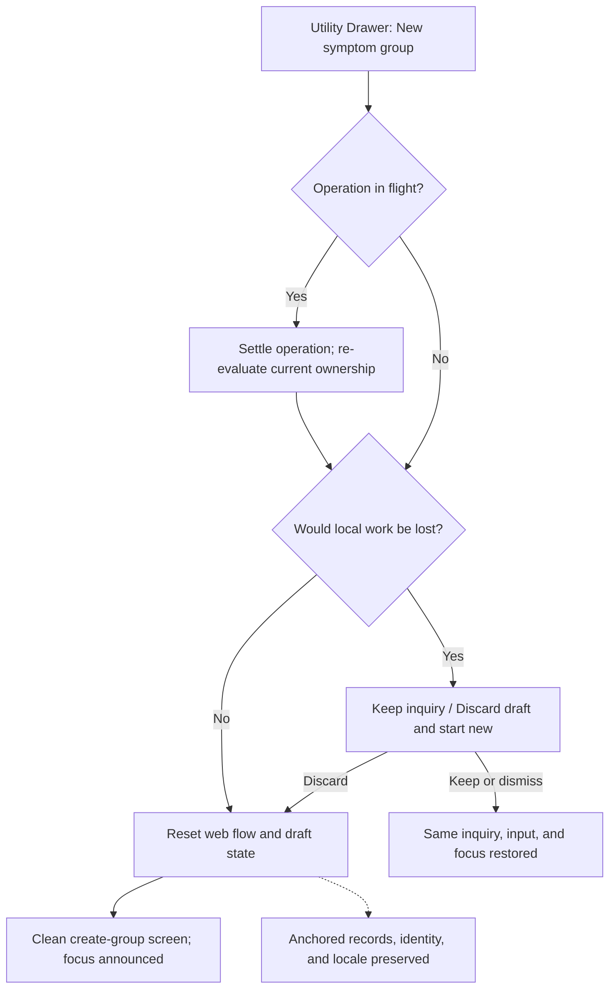

# Wave 12: Session Reset, Brand Color Alignment, Terminology Evolution, and Real Authentication

**Date:** 2026-10-13 (Asia/Jerusalem).

**Inspected baseline:** `772df65`.

**Status:** Technical specification and high-level work plan; no implementation or ticket breakdown.

**Implementation boundary:** `packages/pic-web`; no engine, adapter, schema, seed, or migration changes.

**Method:** `to-spec` synthesis, using the repository's domain vocabulary and existing testing seams.

The user confirmed three pre-flight decisions: require email verification before anchoring work; retain the
Guest draft while verification is pending; use the existing application/Gate testing seams without engine or
adapter changes. The user also authorized documented brand-derived shades for accessibility only.
This document is the sole deliverable. The skill's issue-publication step is superseded by the explicit request
for a local specification without tickets.

## Problem Statement

An Event Manager cannot explicitly leave the current Symptom Group and begin a fresh inquiry from the Utility
Drawer. The interface uses a provisional sage/lavender palette and abbreviated Hebrew terminology. Its
Persistence Gate exposes development authentication rather than registration and login for real users.

These gaps affect trust and control: starting over must be intentional, familiar branding must remain readable,
muscle-test wording must be understandable, and choosing to save must preserve the work already performed.

## Solution and Feature Objectives

- **Capability:** New Symptom Group
  **User outcome:** Start a fresh inquiry, with confirmation when local work would be discarded.
  **Architectural commitment:** One web composition action resets flow and drafts through existing public contracts.

- **Capability:** Brand alignment
  **User outcome:** Recognizable official colors with accessible controls and readable surfaces.
  **Architectural commitment:** Tailwind v4/CSS token changes only for the palette capability.

- **Capability:** Explicit terminology
  **User outcome:** Read `נכון ומדויק` and support a future personal phrase.
  **Architectural commitment:** Typed presentation interpolation through the existing i18n context.

- **Capability:** Real authentication
  **User outcome:** Register or sign in at the Persistence Gate and retain session continuity.
  **Architectural commitment:** Supabase Auth plus the existing atomic promotion path; verified identity before persistence.


The main frame retains at most two direct choices. Reset and account utilities remain secondary surfaces.
The Event Manager owns therapeutic decisions; UI copy, authentication, and colors never decide treatment success,
reveal prior ratings, select a path, or increment use counts.

## User Stories

1. As an Event Manager, I want a new-group action in session utilities, so that I can start another inquiry anytime.
2. As an Event Manager, I want to return to the initial group-creation screen, so that the next inquiry starts clearly.
3. As an Event Manager, I want confirmation before losing an unanchored draft, so that discarding remains my choice.
4. As an Event Manager, I want Cancel to preserve my exact screen and input, so that reconsidering costs no work.
5. As an Event Manager, I want an empty inquiry to reset immediately, so that unnecessary prompts do not interrupt me.
6. As an authenticated Event Manager, I want saved groups preserved when starting over, so that my history remains mine.
7. As an Event Manager, I want starting over to leave language and identity intact, so that preferences remain stable.
8. As an Event Manager, I want reset to avoid declaring Finish, so that starting over never invents therapeutic success.
9. As a keyboard user, I want predictable confirmation focus, so that I can choose without a pointer.
10. As a screen-reader user, I want a clear new-inquiry announcement, so that I understand the transition.
11. As an Event Manager, I want official PiC colors, so that the application feels consistent with the method's website.
12. As a low-vision user, I want readable text and visible focus, so that branding does not obscure controls.
13. As an Event Manager, I want pending, selected, and recovery states distinguishable without color alone, so that I can act.
14. As a Hebrew reader, I want `נכון ומדויק` in interface prompts, so that I need not decode an abbreviation.
15. As an Event Manager, I want the same phrase in visible and accessible labels, so that instructions remain consistent.
16. As a future customization user, I want my chosen phrase resolved centrally, so that it can appear consistently.
17. As an Event Manager, I want wording changes to leave personal content untouched, so that my own language stays mine.
18. As a bilingual Event Manager, I want locale changes to preserve drafts and answers, so that language is presentation only.
19. As a Guest, I want the complete inquiry available before registration, so that I can experience it freely.
20. As a Guest ready to save, I want registration with Name, Email, and Password, so that I can create my own account.
21. As a returning user, I want login with Email and Password, so that I can save into my existing account.
22. As a registrant, I want clear email-verification guidance, so that I understand when my work can be saved.
23. As a registrant, I want my draft retained while verifying, so that leaving to read email does not erase it.
24. As an Event Manager, I want authentication to preserve group and session IDs, so that my inquiry remains continuous.
25. As an Event Manager, I want a retry after network or profile-creation trouble, so that my draft remains recoverable.
26. As an Event Manager, I want repeated submissions to save once, so that my timeline and use count remain accurate.
27. As an Event Manager, I want explicit control over declining persistence, so that closing a dialog never silently erases work.
28. As a password-manager user, I want correctly labeled fields and autocomplete, so that sign-in is straightforward.
29. As a mobile user, I want the forms usable in RTL and LTR, so that the keyboard and long messages do not hide actions.
30. As an Event Manager, I want my work associated only with my verified identity, so that another account cannot receive it.

## Implementation Decisions

### Architectural and Component Impact Analysis

- **Existing module or boundary:** TherapeuticScreenFrame / TherapeuticSheet
  **Current behavior:** Shared accessible drawer; language selector and screen utilities.
  **Wave 12 responsibility:** Common new-group entry and controlled confirmation/focus handoff.

- **Existing module or boundary:** GuestFlowRouter and flow facts
  **Current behavior:** Derive one of five screens from active IDs and completion flags.
  **Wave 12 responsibility:** Production reset action and a flow generation for stale-work protection.

- **Existing module or boundary:** Composition root and engine contexts
  **Current behavior:** Own adapters, engine instances, wrapped actions, and reflected stores.
  **Wave 12 responsibility:** Coordinate reset, auth, profile preparation, promotion, and cache invalidation.

- **Existing module or boundary:** Creation/rating screen drafts
  **Current behavior:** Some input exists only in React state before any group ID exists.
  **Wave 12 responsibility:** Expose whether a draft would be lost; clear only after confirmed reset.

- **Existing module or boundary:** PersistenceGateModal
  **Current behavior:** Uses test credentials; disabled social placeholders; incomplete modal lifecycle.
  **Wave 12 responsibility:** Accessible register/login/verification/recovery states using real credentials.

- **Existing module or boundary:** Promote path
  **Current behavior:** Assembles a pending Finish snapshot and swaps repository for atomic promotion.
  **Wave 12 responsibility:** Replace production stub entry, ensure own profile, serialize promotion, recover safely.

- **Existing module or boundary:** LocaleProvider and typed dictionaries
  **Current behavior:** Hebrew/English, typed placeholders, truthful fallback metadata.
  **Wave 12 responsibility:** `customNemarAlias`, default phrase resolution, and terminology-bearing templates.

- **Existing module or boundary:** Visual foundation
  **Current behavior:** Tailwind v4 static tokens consumed by existing controls and CSS.
  **Wave 12 responsibility:** Official base colors and traceable accessible derivatives.

- **Existing module or boundary:** SessionEngine / PlayerEngine / RepositoryPort
  **Current behavior:** Own gate, promotion, Finish, and therapeutic rules.
  **Wave 12 responsibility:** Consume existing public contracts unchanged.

- **Existing module or boundary:** Local Guest and Supabase adapters
  **Current behavior:** Local storage and atomic server persistence.
  **Wave 12 responsibility:** Reuse unchanged; no new client-side multi-insert therapeutic persistence.


Only the composition root and existing promote-path boundary may import adapters. Components use contexts/actions.
New auth coordination lives within the web package and returns UI state; it does not become a parallel therapeutic
engine. Existing dependency rules remain enabled. No test-only reset helper becomes a production API.

### A. New Symptom Group and Session Reset

**Meaning:** Starting a new inquiry detaches the active focus. It does not delete, archive, or rename an anchored
Symptom Group. Symptom Groups remain perpetually available under DEC-013. A fresh group is created through
GroupEngine only when the Event Manager submits the new name; reset itself creates no empty persisted group.

Expose `קבוצת סימפטומים חדשה` / `New symptom group` in the common Utility Drawer across all five inquiry screens.
The action remains outside the main AtomicActionLayout. A web-owned coordinator determines whether resetting
would discard work, including typed text before group creation, unsaved symptom/rating input, local Guest entities,
active Player work, and a pending persistence request. Presence of an active ID alone is not a sufficient dirty check.

| Situation | Required result |
| --- | --- |
| Empty initial screen | Return to a clean initial screen without confirmation. |
| Unanchored Guest work or unsaved form draft | Show two choices: keep current inquiry; discard local draft and start new. |
| Anchored data with no unsaved input | Detach focus immediately; leave persisted records and identity intact. |
| Anchored data plus unsaved input | Confirm discarding only the unsaved input; keep existing records. |
| Auth or persistence operation in flight | Serialize with reset; do not clear a snapshot while it may be promoted. |
| Storage/pending write failure | Retain current work and offer a calm retry; do not announce reset success. |

Confirmation describes local loss explicitly and never implies deletion of saved history. Cancel, Escape, and
outside dismissal do not invoke discard. Focus initially favors keeping the current inquiry. Avoid stacked modal
focus traps: use a controlled confirmation surface in the Sheet lifecycle. On success close the Sheet and focus
the initial heading/name field; on cancel restore the reset trigger. Localize all text and live announcements.

The coordinator must settle outstanding writes before clearing local state, invalidate stale read callbacks, then
reset active group/player IDs, symptom-addition/finalization/summary flags, draft values, reveal overrides, and
screen-local recovery state as one visible transition. A new flow generation prevents an old async response from
reopening the discarded inquiry. Remounting only the flow subtree can clear ephemeral forms; locale/auth providers
must remain mounted. Reset during the initial screen must also clear typed input without requiring a screen change.

Use existing SessionEngine gate-discard behavior where applicable and LocalGuestRepository cleanup through the
composition boundary. Clear Guest storage last: current flow setters can otherwise recreate its blob. Fix the
current web discard wrapper's incomplete active-group/flag cleanup through this shared coordinator. Never clear
all browser storage, call sign-out as part of reset, or call Finish/Finish Anyway as an exit shortcut. Preserved
Player sessions retain their existing states; the UI does not invent a new completion or failure transition.



### B. Official Brand Palette and Design Tokens

The official homepage's linked Elementor kit declares primary `#5B9C85`, secondary `#9B89A3`, accent `#81C7AF`,
and white `#FFFFFF`. Its page CSS also uses `#7FC6B0` on a prominent CTA and neutral `#454545` for text.
These are observed website values, not a claim that a separate brand manual was supplied.
[Official kit CSS](https://pic-healing.com/wp-content/uploads/elementor/css/post-2657.css?ver=1752417329)
and [homepage CSS](https://pic-healing.com/wp-content/uploads/elementor/css/post-4973.css?ver=1763487290),
retrieved 2026-10-13, are the palette evidence. Do not collect arbitrary WordPress/plugin colors as brand tokens.

Declare the exact official base colors once. Existing `pic-sage-*` and `pic-lavender-*` names may remain compatibility
aliases so components need no palette-driven markup changes. Map the green and purple families to those bases;
eliminate unrelated provisional green casts from surfaces, borders, shadows, and focus offsets. White remains the
reading surface, and official neutral ink can supply readable text. Preserve dimensions, typography, spacing,
motion, radii, and action semantics.

- **Token role:** Brand primary / sage-500
  **Proposed mapping or derivation:** Exact `#5B9C85`
  **Purpose:** Official identity; not ordinary white-text button fill.

- **Token role:** Brand accent
  **Proposed mapping or derivation:** Exact `#81C7AF`
  **Purpose:** Accent/decorative surfaces.

- **Token role:** Brand secondary / lavender-500
  **Proposed mapping or derivation:** Exact `#9B89A3`
  **Purpose:** Official secondary identity.

- **Token role:** Surface
  **Proposed mapping or derivation:** Exact `#FFFFFF`
  **Purpose:** Reading cards, Sheet, forms.

- **Token role:** Ink / readable neutral
  **Proposed mapping or derivation:** Observed `#454545`
  **Purpose:** Body text on white and sufficiently light tints.

- **Token role:** Primary button / sage-700
  **Proposed mapping or derivation:** 75% primary + 25% black in sRGB: `#447564`
  **Purpose:** Accessible fill for existing white text.

- **Token role:** Focus / lavender-700
  **Proposed mapping or derivation:** 65% secondary + 35% black in sRGB: `#65596A`
  **Purpose:** Dark accessible focus/border role.

- **Token role:** Sage-50/100/200
  **Proposed mapping or derivation:** 8% / 16% / 30% accent mixed with white
  **Purpose:** Readable green surface hierarchy.

- **Token role:** Lavender-50/100/200
  **Proposed mapping or derivation:** 6% / 12% / 25% secondary mixed with white
  **Purpose:** Readable secondary surface hierarchy.

- **Token role:** Sterile, line, quiet, gradients, shadows
  **Proposed mapping or derivation:** Semantic aliases from the same bases/neutral colors
  **Purpose:** Remove independent, untraceable hues.


The derived mixes are application accessibility decisions, not official website swatches. Record the base,
mixing space, proportion, resolved value, and contrast for every derivative adopted in implementation.
Adjust a proposed mix only if computed contrast across its actual roles requires it.

Calculated opaque sRGB contrast: white on primary is approximately 3.21:1; white on accent is 1.96:1; white on
secondary is 3.23:1. None passes 4.5:1 for normal text. White on proposed `#447564` is approximately 5.28:1.
Therefore blindly replacing the current dark button token with the official primary would regress accessibility.

Acceptance requires at least 4.5:1 for normal text, 3:1 for large text and required control/focus boundaries, measured
on actual backgrounds including gradients and alpha composition. Check default, hover, pressed, selected, recovery,
and focus states; do not rely on an accent ring alone. Existing dark outlines can be retokenized for contrast.
Palette implementation changes only Tailwind v4/CSS token definitions and aliases in the web package. Updating
web test expectations for the new contract is permitted; per-component hardcoded replacements are not the strategy.

### C. Explicit Terminology and `customNemarAlias`

Replace the Hebrew abbreviation in all interface dictionary values, including headings, questions, navigation
labels, recovery text, and accessible names. Audit ASCII quotation marks, Hebrew gershayim, and typographic variants.
Use natural sentence templates, for example `האם נכון ומדויק לטפל בסימפטומים האלה יחד?` and
`האם נכון ומדויק שטיפול זה הסתיים בהצלחה?`; do not mechanically leave grammatically broken headings.

Add the client-only optional `customNemarAlias` value and a setter to the existing i18n context. For Wave 12 the value
is in-memory presentation state, defaulting to null; no settings editor, profile column, or account synchronization
is required. Empty/whitespace-only input resolves to the default. The Hebrew default is exactly `נכון ומדויק`.
Keep the existing English `NEMAR` default because this request replaces the Hebrew abbreviation; a later English
editorial change can be made independently. A supplied alias is literal user wording and is not translated.

Resolve the phrase through typed, designated terminology placeholders in the existing message resolver. The bound
context supplies the alias internally, preserving caller type checking, required parameters, plural handling,
fallback language metadata, and text/parts agreement. Resolve locale defaults for the actual fallback template's
language. Render user wording as escaped text with bidi isolation; never HTML or template source. Do not perform
a global replacement over rendered DOM or authored treatment content.

Locale or alias changes must not remount the inquiry, mutate engine state, clear inputs, reveal ratings, alter
Terminal responses, or change eligibility for Finish Anyway. Reset keeps the current alias. Canonical domain and
payload identifiers such as Terminal NEMAR and `terminal_nemar_no` remain unchanged. Personal names, journal text,
source content, approved content overlays, parser unit IDs, seeds, and server language preferences are outside this
dictionary change. A UI string outside the dictionary must be routed into it, not patched by a DOM replacement.

### D. Real Authentication and Persistence Gate

**DEC relationship:** DEC-017 currently specifies Social Auth with Magic Link fallback. The user's Wave 12 request
explicitly selects Email/Password for this wave. This specification records that bounded mechanism change; it does
not claim DEC-017 already specifies passwords or silently rewrite the canonical decision. Guest-first inquiry,
explicit anchoring, identity ownership, and atomic promotion remain mandatory. DEC-018 continues to govern
promotion idempotency and Finish replay. Social, Magic Link, biometric unlock, and account deletion are deferred.

**Form contract:** Registration requires Name, Email, Password; login requires Email and Password. Store the trimmed
name as Supabase Auth `full_name` metadata and initialize the existing own profile when needed. Do not normalize or
trim passwords. Use native labels, email input, password-manager autocomplete, sensible validation tied to the
configured server password policy, and field-linked localized recovery messages. Never persist passwords in custom
storage, logs, URLs, fixtures shipped to users, or telemetry. Only public Supabase configuration belongs in the
browser. Production UI must not read tracer-user credentials or expose development sign-in and disabled providers.

Use the existing Radix dialog foundation for modal focus trapping, an inert background, localized title/description,
and focus restoration. The current bare open dialog is not sufficient evidence of accessibility. Registration/login
mode changes retain non-secret form input and stable focus; status announcements must not repeatedly steal focus.

**Auth contract:** Use the installed Supabase client with `signUp` and `signInWithPassword`, and one web-owned client
lifecycle. With email confirmation enabled, signup can return a user without a session; this enters verification
pending and cannot promote. Persist Name via auth metadata, retain Guest state, and show neutral delivery guidance.
A non-null signup user alone is not verified identity. After verification, sign in on the original browser or
process an allowed callback there. Use the authenticated user's ID, never an editable field, as the owner.
[Supabase signup API](https://supabase.com/docs/reference/javascript/auth-signup).

Enable email confirmation, configure the allowed application return URL and working email delivery in the target
Supabase environment before release. These are deployment prerequisites, not changes made by this specification.
Handle expired links, resend/rate limits, credential rejection, offline state, and missing configuration without
discarding drafts. A callback on another device verifies identity but cannot transfer the original device's local
Guest data; explain returning to the original browser. A password reset journey is deferred explicitly.
[Supabase password authentication](https://supabase.com/docs/guides/auth/passwords).

**Profile dependency:** The inspected schema references `profiles(id)` from therapeutic records, but has no signup
trigger; existing integration fixtures manually seed profiles. Real signup must not depend on that fixture setup.
Before promotion, the existing web auth/promote boundary must ensure the signed-in user's own profile exists via
the authenticated Supabase client and existing RLS. Insert missing `id`/`full_name` idempotently, preserve an existing
profile's name/preferences, and handle concurrent creation by re-reading the own row. Name metadata is display
data, never authorization. Profile failure leaves the Guest snapshot retryable. This is identity bootstrap, not
client-side persistence of therapeutic rows; no adapter or database migration is proposed. Verify deployed RLS
supports this path before release rather than introducing a service-role key into the browser.

**Promotion contract:** Auth success and saved work are separate states. Assemble the existing finalized group plus
PlayerSession snapshot for the pending Finish, preserving UUIDs, symptom ratings, links, unit progress, and terminal
answer. The unlinked Player path retains `group: null`. Prepare the profile, bind the authenticated repository through
DelegatingRepositoryPort, and invoke the existing SessionEngine promotion action. The engine/RPC owns normalization,
atomic writes, and Finish replay; UI never reimplements these or adds a second Finish call on the success path.

Maintain one in-flight operation for a flow generation and verified owner. Freeze its snapshot/idempotency key so
duplicate clicks, callbacks, and retries cannot create divergent requests. RPC failure restores the previous
repository provider and retains local work; an authenticated identity can retry saving without another password
prompt. Block concurrent reset or therapeutic writes during the provider swap. Repeated callbacks must not promote
an old snapshot after reset or into a different user; a changed owner requires a fresh explicit anchoring action.

The current composition callback clears Guest storage before all post-RPC bookkeeping settles. Wave 12 must defer
web-owned cleanup until the promotion action and required completion reconciliation have settled, retaining a
web-owned recovery envelope when a response or cleanup is interrupted. The envelope contains the frozen snapshot,
owner, pending Finish kind, and flow generation, never credentials. Clear it after confirmed completion or explicit
local discard. If the RPC committed but the response was lost, retry its exact payload/key. If only post-promotion
completion failed, use existing idempotent public completion contracts to reconcile; do not count another success.
This is a required web orchestration correction, not an engine transaction redesign.

**Verification continuity:** Preserve the pending gate and Guest draft through reload in the original browser while
waiting for email verification, using existing local storage contracts. Do not equate overlay dismissal, switching
register/login forms, or opening email with the Event Manager's explicit choice to discard. The decline action
must explain local loss and use the shared confirmation/reset behavior. Cancellation of that confirmation restores
the gate and the draft. During pending requests expose progress and prevent duplicate/destructive submission.

**Returning identity and engine limitation:** Supabase identity can be restored independently of therapeutic
SessionEngine mode. The inspected engine starts in Guest mode and has no authenticated-bootstrap setter; do not
mutate its private state or create a fake promotion merely to log in. Within the same runtime, successful promotion
keeps the authenticated provider for subsequent work. After a fresh load, a new unanchored inquiry may use local
Guest storage even for a restored identity; at its real Persistence Gate, reuse that verified identity to promote
without asking for credentials again. Never label that local work as already saved. Previously anchored records
remain on the server. Browsing/resuming those records after reload is not implemented by the current shell and is
outside this wave; full authenticated workspace hydration requires a separate domain seam decision.

Session expiry or an external sign-out must stop authenticated writes and require reauthentication before retry,
without treating an already-anchored record as a disposable Guest snapshot. Keep owner-specific caches separate.
General account switching/profile management is outside scope; it must not be implicitly enabled by swapping a
user ID in the promotion request.

```mermaid
sequenceDiagram
    actor EM as Event Manager
    participant UI as Persistence Gate
    participant Web as Web auth and composition
    participant Auth as Supabase Auth
    participant Local as Local Guest storage
    participant Engine as SessionEngine
    participant DB as Existing Supabase adapter and RPC
    EM->>UI: Finish / Finish Anyway requests anchoring
    UI->>Web: Register or sign in
    Web->>Auth: Email/Password; name metadata for registration
    alt Verification required
        Auth-->>Web: User without session
        Web-->>UI: Verification pending
        Note over Local: Retain draft and pending gate through reload
        EM->>Auth: Verify email, then establish session
    end
    Auth-->>Web: Verified authenticated identity
    Web->>DB: Ensure own profile exists through RLS
    Web->>Local: Read and freeze pending Guest snapshot
    Web->>Engine: Promote through authenticated repository
    Engine->>DB: Atomic promotion with stable idempotency key
    alt Promotion confirmed
        DB-->>Engine: Persisted result
        Engine->>DB: Existing Finish reconciliation, if needed
        Engine-->>Web: Completion settled
        Web->>Local: Clear Guest state and recovery envelope
        Web-->>UI: Saved; continue existing flow
    else Retryable failure or uncertain response
        Web-->>UI: Retry saving; retain authenticated identity if valid
        Note over Local: Keep exact snapshot and pending intent
    end
```

- **State/data:** Name/email/password form
  **Owner and lifetime:** Web form; password transient only
  **Must not contain or cause:** Therapeutic data in Auth metadata; password persistence.

- **State/data:** Auth identity/session
  **Owner and lifetime:** Supabase SDK with web context reflection
  **Must not contain or cause:** Fabricated SessionEngine authenticated state.

- **State/data:** Own profile
  **Owner and lifetime:** Existing Supabase profile under RLS
  **Must not contain or cause:** Overwrite of existing preferences during login.

- **State/data:** Guest group, Player, pending Finish
  **Owner and lifetime:** Existing Guest repository until anchoring/discard
  **Must not contain or cause:** Anonymous server therapeutic records.

- **State/data:** Promotion recovery envelope
  **Owner and lifetime:** Web-only, owner-bound, removed after completion/discard
  **Must not contain or cause:** New server transaction or altered RPC schema.

- **State/data:** Locale and `customNemarAlias`
  **Owner and lifetime:** Existing i18n context; alias in-memory
  **Must not contain or cause:** Inclusion in therapeutic promotion payloads.

- **State/data:** Reset generation and draft dirty facts
  **Owner and lifetime:** Web composition/presentation
  **Must not contain or cause:** Duplicated ratings, treatment state, or business rules.


The existing gate implements Finish/Finish Anyway. Journal sync and explicit Persist Group are DEC-017 concepts
but do not have equivalent pending-action contracts in the inspected flow. Do not invent them as hidden Wave 12
requirements or pass incomplete groups into the existing promotion RPC.

## Testing Decisions and Quality Gates

The primary test seam is the assembled application shell: perform real user actions through the Sheet, initial
screen, Player, and Persistence Gate. Extend existing component/application tests for reset and auth orchestration;
use focused dictionary/token tests for pure presentation contracts. This matches the user's confirmed boundaries.
Prefer observable state, persistence outcomes, focus, and absence of data loss over internal function-call snapshots.

Prior art includes the existing happy-path and promotion-path tests, persistence-gate tests, Guest flow/router
tests, localized creation/Player tests, locale-provider/message tests, visual-foundation contrast tests, and the
bilingual Guest-flow browser journey. Reuse these fixtures and public engine contracts rather than adding new
production test seams. Deterministic Auth responses test UI states; real Supabase evidence separately proves Auth,
RLS, profile bootstrap, and promotion. Mock-only success is insufficient to release real registration.

| Area | Required behavioral evidence |
| --- | --- |
| Reset | Empty flow; typed name with no ID; symptom/rating draft; finalized Guest group; active Player; pending gate. |
| Sovereignty | Cancel/Escape preserve work; confirm starts clean; saved groups survive; no Finish or use-count change. |
| Concurrency | Slow writes/auth/promotion cannot resurrect a reset flow; duplicate actions settle once. |
| Terminology | All Hebrew quote variants removed from UI dictionaries; default/custom/blank alias; escaped text and fallback. |
| Continuity | Locale/alias changes preserve input, IDs, unit, terminal answer, blind ratings, and voluntary links. |
| Branding | Exact base tokens, documented derivatives, computed contrast on actual surfaces in every control state. |
| Registration | Name/email/password; session-null verification; resend/expired link; same-browser reload without draft loss. |
| Login | Existing user; wrong credentials; unavailable network/config; reuse restored verified identity at the gate. |
| Profile bootstrap | Truly new account without a pre-seeded profile; repeated login preserves existing profile/preferences. |
| Promotion | Linked/unlinked sessions; same UUIDs; correct owner; one timeline/use increment; retry after lost response. |
| Recovery | Profile/RPC/post-RPC interruption retains enough state to recover; no false saved announcement. |
| Accessibility | Keyboard trap/restoration, announcements, labels, autocomplete, RTL/LTR, long text, zoom, reduced motion. |

The inherited green baseline is **442 root unit/integration tests and 161 configured Chromium Playwright tests**,
as recorded in the Wave 11 handoff. These counts are historical evidence, not newly executed results in this
documentation-only turn. Preserve all existing behavioral coverage and add Wave 12 cases. Expected brand values,
copy, and development-auth assertions may be updated for the intentional new contract; never delete scenarios,
skip failing tests, weaken contrast thresholds, or increase retries to claim green.

- **Gate:** Typecheck
  **Command / scope:** Root `npm run typecheck`
  **Acceptance:** All four workspaces pass; typed i18n/action contracts remain intact.

- **Gate:** Lint
  **Command / scope:** Root `npm run lint`
  **Acceptance:** No new violations.

- **Gate:** Unit/integration and dependency boundaries
  **Command / scope:** Root `npm test`
  **Acceptance:** Full baseline plus added cases pass; all-workspace depcruise passes.

- **Gate:** Focused web checks
  **Command / scope:** Web workspace `npm test` and `npm run depcruise`
  **Acceptance:** Relevant components and new flows pass without boundary exceptions.

- **Gate:** Browser regression
  **Command / scope:** From web workspace: `npx playwright test --workers=2`
  **Acceptance:** All inherited 161 cases and added cases pass with unchanged retry policy.

- **Gate:** Production build
  **Command / scope:** Web workspace `npm run build`
  **Acceptance:** Build succeeds; production auth does not depend on tracer credentials.

- **Gate:** Scope audit
  **Command / scope:** Diff against wave implementation baseline
  **Acceptance:** Runtime/tests/CSS remain in web; no engine, adapter, or schema edits.

- **Gate:** Real auth validation
  **Command / scope:** Isolated Supabase accounts using actual signup/login and confirmation
  **Acceptance:** Own profile and promotion succeed; no manual profile seeding hides the dependency.


Use both locales at 320x568, 390x844, 768x1024, and 1440x900 CSS pixels. Keep the main viewport at `100dvh`, with
long content and auth forms scrolling internally. Manually verify mobile keyboard/visual viewport, physical-device
safe areas, zoom, and Hebrew screen-reader pronunciation; Chromium automation does not establish these results.
Preserve offline Guest inquiry after the application's available assets load; real authentication requires network.

Root tests include remote suites with explicit credentials and fixture cleanup. Run them using the existing remote
test process, retain TLS verification, and report missing infrastructure as unverified rather than silently skipped.
Email confirmation requires a controlled test mailbox/verification facility; production confirmation must not be
disabled just to make tests pass. No remote users, email, or configuration are changed during specification work.

## High-Level Work Plan

1. Establish the web composition lifecycle contract for reset, draft ownership, stale actions, and promotion cleanup.
   Confirm profile bootstrap/RLS and email-verification deployment prerequisites using existing interfaces.
2. Establish presentation foundations: exact brand tokens and accessible derivatives; typed terminology alias;
   bilingual reset/auth messages. Keep token-only palette work independent of state orchestration.
3. Integrate reset into the common Utility Drawer and all current inquiry stages, including initial unsaved input.
4. Integrate real registration/login/verification with profile preparation and the existing persistence pipeline;
   cover verified identity separately from saved-work status and implement retry-safe cleanup.
5. Validate the assembled reset-to-inquiry-to-auth journey, run all quality gates, and document evidence and limitations.

These are dependency phases, not tickets or agent assignments. Shared composition and dictionaries require a
coherent integration order. No worktrees, issue publication, runtime edits, or implementation commits are part of
this specification turn.

## Out of Scope

- Engine/adapter/RepositoryPort API changes, RPC rewrites, migrations, seeds, and framework/dependency upgrades.
- Deleting or archiving saved groups as part of reset; library/history browsing or authenticated workspace hydration.
- New Journal-sync/Persist-Group gate entry points, subscription billing, offline synchronization/conflict resolution.
- Social OAuth, Magic Link, biometrics, password recovery, account deletion, account switching, and profile editing UI.
- A custom-alias editor, server persistence of aliases, canonical domain renaming, or rewriting authored guidance.
- Typography/layout redesign or component-by-component palette styling outside CSS/Tailwind design tokens.

## Further Notes and Evidence

Repository evidence: [project instructions](../../../../AGENTS.md), [manifesto](../../../../CLAUDE.md),
[canonical domain vocabulary](../../../../CONTEXT.md), [DEC-017 and DEC-018](../../../../decisions.md),
[Wave 11 specification](../../wave-11/specs/wave-11-i18n-spec.md), [Wave 11 handoff](../../wave-11/handoffs/wave-11-handoff.md),
and [remote testing contract](../../../testing/supabase-remote-testing.md).

Source inspection established the current reset omissions, production auth stub, missing profile trigger,
promotion cleanup ordering, and lack of an authenticated engine-bootstrap interface. The designs above address
the requested gate journey inside the confirmed web-only seam and explicitly delimit wider account lifecycle work.
If implementation proves that a required invariant cannot be met through these public contracts, record the
specific dependency and revise the specification before crossing the seam; do not patch engine internals from UI.

Release prerequisites are verified email delivery/redirect settings, deployed own-profile RLS, real promotion
evidence, and the stated accessibility checks. These are validation requirements, not claims that hosted settings
or the planned implementation have already been verified.
