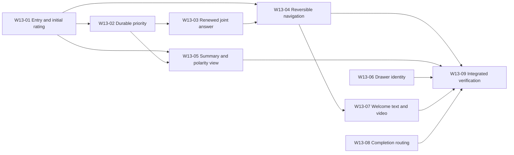

# Wave 13 Ticket Index

**Date:** 2026-10-20 (Asia/Jerusalem).
**Status:** W13-01, W13-02, W13-03, W13-04 and W13-06 closed; clean checkpoint before W13-05.

[Wave index](../INDEX.md) · [Approved specification](../specs/wave-13-spec.md) ·
[Content audit](../audits/wave-13-content-audit.md) · [Master wave index](../../INDEX.md)

This local suite is the requested publication target. Implementation is authorized according to the DAG.
The later continuous-orchestration charter permits independent W13-06 and W13-08 branches in parallel.
The user explicitly requested generation and commit before review, so no additional pre-generation interview is required.
There are exactly nine tickets; approved W13-07V is included inside W13-07.

## Dependency DAG

- **Ticket:** [W13-01][W13-01]
  **Status:** closed; implementation commit 8443a35.
  **End-to-end delivery:** Enter, rate and prioritize unified draft rows; commit once and reach the joint test
  **Blocked by:** None

- **Ticket:** [W13-02][W13-02]
  **Status:** closed; 64 files / 632 tests pass against the updated real schema, with no failures or skips.
  **End-to-end delivery:** Reorder topics and preserve priority through storage and promotion
  **Blocked by:** W13-01

- **Ticket:** [W13-03][W13-03]
  **Status:** closed; 66 files / 686 tests pass against the updated real schema, no failures or skips.
  **End-to-end delivery:** Add to an answered list and confirm the full revised list again
  **Blocked by:** W13-02

- **Ticket:** [W13-04][W13-04]
  **Status:** closed; 68 files / 711 real-schema tests and 26 Chromium journeys pass, both review axes pass.
  **End-to-end delivery:** Navigate backward through the questionnaire without losing work
  **Blocked by:** W13-01, W13-03

- **Ticket:** [W13-05][W13-05]
  **Status:** next entry; prerequisites complete, implementation not started at this checkpoint.
  **End-to-end delivery:** Review a clean priority list with an optional polarity view
  **Blocked by:** W13-01, W13-02

- **Ticket:** [W13-06][W13-06]
  **Status:** closed; 587 root tests and 11 targeted browser cases pass; see ticket Resolution.
  **End-to-end delivery:** Show a personal greeting and accurate account state in the drawer
  **Blocked by:** None

- **Ticket:** [W13-07][W13-07]
  **End-to-end delivery:** Learn PIC through a welcome page, text guide and official video
  **Blocked by:** W13-04

- **Ticket:** [W13-08][W13-08]
  **End-to-end delivery:** Return clearly after Finish while preserving all treatment content
  **Blocked by:** None

- **Ticket:** [W13-09][W13-09]
  **End-to-end delivery:** Prove the complete Wave 13 journeys and deliver the reviewed handoff
  **Blocked by:** W13-04, W13-05, W13-06, W13-07, W13-08

[W13-01]: w13-01-instant-questionnaire-and-initial-rating.md
[W13-02]: w13-02-durable-manual-priority.md
[W13-03]: w13-03-renewed-joint-answer-after-addition.md
[W13-04]: w13-04-reversible-questionnaire-and-recovery.md
[W13-05]: w13-05-clean-summary-and-polarity-view.md
[W13-06]: w13-06-drawer-greeting-and-identity.md
[W13-07]: w13-07-welcome-text-guide-and-video.md
[W13-08]: w13-08-post-finish-routing-and-content-hygiene.md
[W13-09]: w13-09-integrated-journeys-and-wave-handoff.md
[H13-03]: ../handoffs/w13-04-verified-and-w13-05-entry.md

W13-04 lists W13-01 explicitly for its draft contract even though W13-03 also depends on it.
W13-05 needs entry/rating and order, not the renewed-answer implementation.
W13-06 and W13-08 have no functional ticket prerequisites; independent dispatch is authorized by the later charter.
W13-07 depends on reversible navigation, not on account greeting or polarity presentation.
W13-09 lists the final dependency frontier; W13-01/02/03 are transitively required.

Suggested serial order is 01 → 02 → 03 → 04 → 05 → 06 → 07 → 08 → 09.
The later continuous-orchestration charter permits independent branches; the dependency DAG remains unchanged.
Shared composition, dictionary and storage owners must not receive simultaneous conflicting edits.

## Vertical slicing and mapping from the earlier proposed breakdown

The original proposal was repackaged as vertical slices. The approved unified-row refinement now updates W13-01.
Use the current ticket scope with the requested
to-tickets methodology: each numbered ticket demonstrates user-visible behavior across all layers it touches.

| Earlier proposed area | Owning generated ticket |
| --- | --- |
| W13-01 semantics/copy and W13-04 entry | W13-01 entry; W13-07 practical guide/copy approval |
| W13-02 engine order and W13-03 storage/promotion | W13-02 complete durable-priority slice |
| Revised membership and renewed joint answer | W13-03 complete atomic revision slice |
| W13-05 Back/rating/summary | W13-01 initial rating; W13-04 Back; W13-05 summary/blind re-rating |
| W13-06 personalized drawer | W13-06 |
| W13-07 introduction/guide and W13-07V video | W13-07, including the now-approved video container |
| W13-08 content hygiene | W13-08 routing correction and content-preserving evidence |
| W13-09 wave closure | W13-09 |

The preflight copy of the earlier specification is preserved under the wave's archive.
Use this ticket index for current ticket IDs and blocking edges.

## Requirement coverage

| Requirement | Owner(s) |
| --- | --- |
| Supplied introduction, optional title, immediate input, progressive loop | 01 |
| Initial 1–10 versus historical/re-rating 0–10 | 01, 05 |
| Local draft priority; durable Guest/account and promotion continuity | 01, 02 |
| Fresh full-list joint answer after an addition; sovereign No | 03 |
| Universal questionnaire Back and draft preservation | 04 |
| Clean list; no totals; optional polarity view; blind integrity | 05 |
| Greeting and accurate identity distinct from saved state | 06 |
| Welcome, Sigal/PIC background, source-based text, YouTube container | 07 |
| Routing-based content hygiene; exact deletion gate | 08 |
| Integrated bilingual, persistence, accessibility and recovery evidence | 09 |

## Content and environment gates

- W13-07 must produce and obtain approval of actual source-verified procedural text. The feature is approved;
  nonexistent/unwritten text is not treated as already reviewed. A missing transcript remains an evidence dependency.
- W13-07 must verify actual YouTube embedding; the known watch URL alone is not proof of embed permission.
- W13-02/03 require authorized isolated database evidence. The user permits cleanup only of same-run fixture UUIDs.
- Physical/native checks remain explicitly visible in W13-09. A prior-wave manual-QA waiver is not automatically inherited.
- W13-04 is closed; resume W13-05 from the [verified checkpoint][H13-03].

## Execution checkpoint protocol

Preflight and the suite were approved. The user's unified-row refinement supersedes W13-01's separate rating pass.
Complete each atomic ticket, run the specified gates, record every AC in Resolution and commit before proceeding.
At context capacity, stop with a clean verified checkpoint and state the exact next ticket and remaining gates.
Content deletion and existing-row deletion remain prohibited without target-specific approval.
